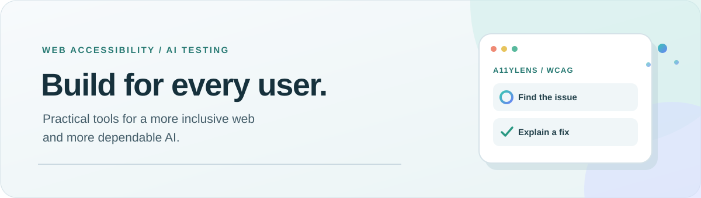

# @lakshay74

<picture>
  <source media="(prefers-color-scheme: dark)" srcset="https://raw.githubusercontent.com/lakshay74/lakshay74/main/assets/profile-dark.svg">
  
</picture>

I build practical tools around web accessibility and reliable AI testing.

## Featured projects

- **[A11yLens](https://github.com/lakshay74/a11ylens-accessibility-auditor)** — A Chrome extension that scans pages for accessibility issues, highlights affected elements, and explains findings with WCAG guidance.
- **[LLM Evaluation & Testing Suite](https://github.com/lakshay74/llm-eval-suite)** — A test harness for answer correctness, out-of-scope refusals, prompt injection, and edge cases, with GitHub Actions CI.

## What's next

**A11yLens Web** — A planned mobile-first URL scanning experience with shareable reports and plain-language explanations. The existing extension remains a separate way to scan pages.

## Tools in these projects

`JavaScript` · `Python` · `FastAPI` · `axe-core` · `WCAG` · `GitHub Actions` · `Groq`

---

[Explore my repositories](https://github.com/lakshay74?tab=repositories) · [View my profile](https://github.com/lakshay74)
